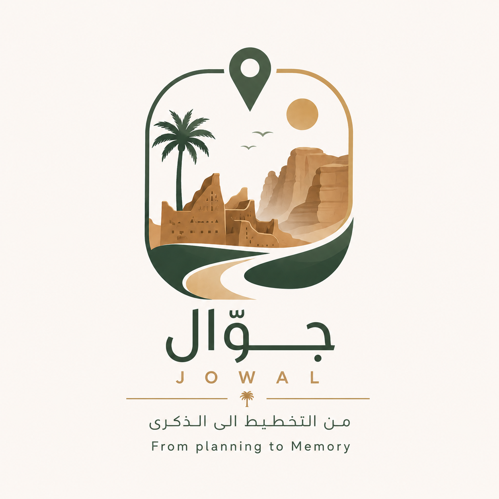

# 

  

<h1 align="center">Jawwal | جوّال</h1>

  <strong>From Planning to Memory</strong>

---

## 🌍 About the Project

Jawwal is an AI-powered tourism assistant designed to transform the travel experience in AlUla.

The project combines smart trip planning, cultural exploration, and memory creation into one seamless experience through a multi-agent AI system.

Developed as part of Innovation Summer 2026 at Qassim University.

---

## 💡 The Problem

Travelers often face several challenges:

- Difficulty choosing suitable destinations.
- Scattered and unreliable travel information.
- Lack of personalized travel plans.
- Limited integration of cultural experiences.
- Difficulty documenting and sharing travel memories.

---

## 🤖 Meet Our AI Agents

Jawwal introduces three specialized AI agents:

### 📍 Jawwal | جوّال
**The Smart Travel Planner**

Creates personalized travel itineraries based on users' interests, preferences, and budgets.

### 🏛️ Rawi | راوي
**The Cultural Storyteller**

Enhances the travel experience by providing cultural and historical insights and highlighting authentic local experiences.

### 🎬 Athar | أثر
**The Memory Creator**

Helps travelers preserve their experiences by creating video storytelling scenarios and social-media-ready descriptions.

---

## 💻 Website Demonstration

Explore the Jawwal website through a short demonstration video.

🎥 [Watch Website Demo](https://drive.google.com/file/d/1OtDlQPUWKry8_2Lekwcf4oocjCedquRe/view?usp=drivesdk)

---

## 🤖 AI Agents Demonstration

Discover how Jawwal's intelligent agents work together to enhance the tourism experience.

🎥 [Watch AI Agents Demo](https://drive.google.com/file/d/1YD_cUTAsSAnP2j3dh_44lRvnUUKAUh83/view?usp=drivesdk)

---

## 📑 Project Presentation

Explore the project idea, challenges, proposed solution, and future development plans.

📄 [View Project Presentation](https://drive.google.com/file/d/1wxBDp9EG4bLlL1DXOiDbmtRhuz9si34s/view?usp=drivesdk)

---

---

## 🏆 Project Achievements & Highlights

### 🌟 September 8, 2026 | University-Level Project Presentation

Following our nomination on September 5, our team had the opportunity to present **Jawwal** before the Vice President for Graduate Studies and Scientific Research at Qassim University.

This opportunity marked an important milestone in showcasing our project at the university level.

📄 [View Achievement Documentation](https://drive.google.com/file/d/1O4wNZ11Ml88J2iwsprYY6sq3tHtRf62w/view?usp=drivesdk)

---

### 🎓 October 6, 2026 | College of Computer Projects Exhibition

Our team proudly showcased **Jawwal** at the College of Computer Projects Exhibition at Qassim University.

During the exhibition, our project booth was visited by distinguished university leaders, including the President of Qassim University, the Dean of the College of Computer, and several faculty members.

The exhibition provided a valuable opportunity to demonstrate our project, share its vision, and engage with the university community.

📄 [View Exhibition Documentation](https://drive.google.com/file/d/1XJG8Wi2WQZqVuIdnHtklmDPYL5__y1xE/view?usp=drivesdk)

---

---

## 🎯 Our Vision

To create an intelligent and integrated tourism experience that connects planning, exploration, culture, and memories in one platform.

---

  <strong>Jawwal — From Planning to Memory 🌴</strong>

